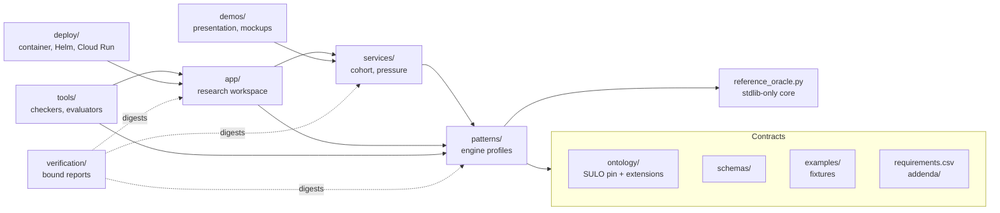

# Design document: patient trajectory matching

Status: describes the repository as of 4 November 2026 (`main` after #103), what it implements, how the parts fit together, and what remains. It synthesizes the normative sources rather than replacing them: the 104 original requirements in [`requirements.csv`](../requirements.csv), the specification [addenda 2.1–2.4](../addenda/), the [architecture](architecture.md), the [completion register](completion.md) and the [issues](issues.md). Where this document and those sources disagree, they win.

## 1. Purpose

Clinical researchers need to find patients whose recorded history follows a specified trajectory — an exposure, a measured change, a sequence of findings — and to know exactly why each patient matched, how close the match was, and how far the records can be trusted.

The difficulty is not search. It is meaning: records are incomplete, timestamps are approximate or recorded late, concepts are coded at different granularities across terminologies, and "nothing found" can mean the patient is well, the data is missing, or the clocks were never comparable. The project's contribution is a set of **executable contracts** that pin these distinctions down, an engine that honours them, and a research workspace that makes them visible.

The full product described by the specifications covers use cases in kidney injury, heart failure and longitudinal diabetes; complete temporal semantics; a coordinated researcher workspace; temporal replay; and a clinical study on MIMIC-IV. The repository implements a bounded, verified subset of that product (§9) and records the rest as open work (§10).

## 2. Design commitments

These hold across every component and are enforced by tests rather than convention.

1. **The graph is the semantic record.** The RDF graph is authoritative; flattened projections exist for execution, and every projected row carries an evidence identifier back to the process, role, bearer, result and source record it came from.
2. **Participation goes through roles; literals through typed information objects.** A trajectory joins on the same person, never the same role individual. `sulo:hasValue` is the only literal-bearing predicate; extensions add classes, not properties.
3. **Kinds of "no" stay distinct.** An inconsistency, a profile violation, an unmatched trajectory, an incomplete search (`UNRESOLVED`) and incomparable clocks (`INCOMPARABLE`) are different results and are never collapsed into "does not match".
4. **Exact, relaxed, possible and certain are different claims.** Entailment is not approximation (cost 0); a declared relaxation has a price; a binding that holds for only some feasible times is *possible*, not *certain*.
5. **Availability is explicit.** Source-as-known selection uses only what was available by a cutoff; retrospective reconstruction may use later corrections, under a distinct label. The two are never silently interchanged.
6. **Nothing overclaims.** Reports carry `production_readiness_claim: false` and `clinical_validity_claim: false`; synthetic, authored and public-demo data are labelled as such; a passing fixture is evidence of a bounded profile only.
7. **Provenance binds outputs to the code that produced them.** Every committed report records sha256 digests of the files that produced it, and a gate fails if a digest no longer matches or a bound file no longer exists.

## 3. System overview

Dependencies point one way. The engine imports nothing from the services, workspace, demos or tools; the services import only the engine; the workspace imports both. The November 2026 reorganization made this true: until #101 the workspace imported its runtime from its own demonstration folder.

| Layer | Location | Role |
|---|---|---|
| Contracts | `ontology/`, `schemas/`, `conformance/`, `examples/`, `requirements.csv`, `addenda/` | What correct means: the pinned SULO 0.2.14 core and application extensions, JSON Schemas, use-case conformance, fixtures, and the product specification |
| Oracle | `reference_oracle.py` | Dependency-free contract oracle for the point-anchor profile; runs on Python 3.10–3.13 |
| Engine | `patterns/` (65 modules, ~10,300 lines, 39 test modules) | The executable profiles: temporal matching, claims and projection, the MIMIC source pipeline, reviewed mappings, measurement sessions, similarity |
| Services | `services/` | Runtime services the workspace uses: the guided synthetic cohort and the reviewed blood-pressure query service with its result cache |
| Workspace | `app/` | The research workspace: HTTP server and pages for similarity and refinement, the guided journey, temporal queries and the interval editor |
| Demonstrations | `demos/presentation/`, `demos/mockups/` | The guided cohort demo and live pressure inspector; exploratory interfaces for defining and matching trajectories |
| Tools and verification | `tools/`, `verification/`, `.github/` | Checkers (provenance, test counts, completion, manifest), evaluators that produce reports, and the CI that runs them |
| Deployment | `deploy/`, `Dockerfile`, `compose*.yaml` | Single-owner container, Compose and Helm; a Cloud Run launcher |

## 4. Semantics

### 4.1 Representation

Clinical facts are encoded with the PRO (participation through roles) and SOLID (literals through information objects) patterns of SULO. Source records become **claims** with explicit acceptance policies; accepted claims project into assertions; the process a claim describes is not asserted until a policy accepts it ([claim projection](claim-projection.md)). Measurements are scalar or point claims with original values and units retained alongside normalized ones ([measurement claims](measurement-claims.md)).

### 4.2 Time

Four independent temporal profiles share the representation discipline without changing each other's semantics ([architecture §5](architecture.md#5-temporal-architecture)):

| Profile | Decides |
|---|---|
| Point anchor (v2.4) | Three-slot exemplar matching with priced relaxation over point events |
| Exact interval 1.0 | Pairwise temporal operators over recorded intervals |
| Interval cohort 1.0 | Conjunctive slot queries across patient episodes, with indexed and reference engines checked against each other |
| Bounded interval 1.0 | Joint feasibility and fixed-witness certain/possible bindings over bounded discrete times |

Later profiles build on them: extended interval queries, robust and metric relaxation, evidence selection with source-as-known and retrospective modes, joint temporal and semantic selection, checked semantic support through rustDL, state validity and coverage, and patient-local clocks ([specifications](specifications.md)).

### 4.3 Matching and cost

| Outcome | Cost |
|---|---|
| Exact concept | 0 |
| Entailed subclass | 0 — entailment is not approximation |
| Reviewed semantic alternative | 1 |
| Temporal extension beyond a limit | Linear, capped |
| Hard value constraint | Never relaxable |

Budgets cap the number of relaxed constraints and the total cost. For uncertain times the oracle prices the worst feasible case; the robust catalogue accepts only bindings certain in every feasible timeline. These are two cost models that price different things; [decision D](decisions/relaxation-cost-models.md) keeps both evaluators under one reported contract.

### 4.4 Similarity

Query by example ranks candidates on pre-index features (findings, age band, baseline values, concepts), with coverage reported beside the score so a sparsely recorded patient cannot look persuasive. **Must match** decides eligibility, **Prefer similar** decides order, **Ignore** removes a feature, **Hide from view** changes only the display. Refinements are immutable revisions with membership deltas ([patient similarity](patient-similarity.md)).

## 5. Data

| Source | Use | Location |
|---|---|---|
| Authored synthetic cohort, 11 patients | Workspace, oracle, similarity fixtures | `examples/guided-cohort/`, `examples/` |
| MIMIC-IV demo 2.2 (open access, ODbL) | Recorded-source pipeline, pressure strata, evaluations; pinned by checksum, never committed | `data/clinical-source-demo-pin.json`, `data/clinical-demographics-demo-pin.json` |
| Derived demo cohort, 140 ICU stays | Workspace ranking over real stays, built locally by `tools/build_demo_cohort.py` | outside the repository |
| Synthetic paediatric rare-disease cohort, 48 patients | Mockups; a hidden truth timeline plus source records with 32 logged kinds of data-quality case | `demos/mockups/synthetic/generate.py` |

No restricted patient data is in the repository. Credentialed MIMIC-IV, ADNI and FHIR sources are specified but await the external dependencies in §10.2.

## 6. Verification and integrity

| Mechanism | What it guarantees |
|---|---|
| Contract suites | 948 contract checks across the engine profiles, counted and checked by `tools/check_test_counts.py` against [status](status.md) |
| Oracle | 16 cases and 9 property checks, on Python 3.10, 3.11, 3.12 and 3.13 |
| Provenance gate | Every committed report's file-to-digest bindings still match: 35 reports, 2,374 bindings. A bound file that moves or disappears fails the gate (#98, #100); it previously passed silently |
| Completion register | All 104 requirements mapped to evidence, acceptance checks and remaining clauses; evidence paths must exist |
| Release manifest | Nine release artifacts pinned by digest |
| Linux-only reports | Three reports measuring process-tree memory through `/proc` are regenerated by the `regenerate-linux-reports` workflow, which refuses a changed invocation |
| CI | Contracts, semantic support, presentation demo, research prototype with container and Kubernetes acceptance, mockups, and three profile workflows on every pull request |

## 7. Interfaces

**Research workspace** (`python -m app.server`, port 8080). `/` similarity and refinement with revisions and exports; `/journey` the guided patient-to-cohort journey, its configurable trajectory builder and the recorded-evidence section; `/temporal` temporal uncertainty; the interval editor. JSON endpoints under `/api/` back each page; `/healthz` and `/readyz` are open, everything else requires the owner login when one is configured.

**HTTP API specification.** `schemas/openapi.json` defines 14 REST paths at contract version 2.0. Nothing serves it, and it predates the PRO/SOLID graph contract at 2.4 ([issues A1, A2](issues.md#services-and-interfaces)).

**Presentation demo** (`demos/presentation/serve.py`, port 8765). The guided cohort replay and the live pressure inspector over the reviewed services.

**Interaction design established by the mockups** (`demos/mockups/`, November 2026). These are designs, not product code, but they settle several questions the workspace will need to answer:

- *Index window, not index point:* each end set at birth, an age, a calendar date, or the Nth/last occurrence of any event with an offset, with time units from seconds to years. Findings count inside the window; diagnoses and genetic results are states established by its end; medicines count if taken during it.
- *Trajectories as constraint graphs:* steps bound to events, constraints on the time between them (`starts between X and Y after`, `happens while taking`), so a sequence, a tree and a graph are one structure. Matching is a simple temporal network solved jointly: *possible* if some choice of times in the recorded ranges satisfies every constraint, *exact* if every choice does. Results are exact, possible, relaxed with a cost, no recorded match, not comparable, or no index period.
- *Terminology search:* one search box across names and codes in every system the terminology table holds, matching narrower concepts through every coding.
- *Data quality as evidence:* each event shows its occurred/recorded/available times, every record behind it, its codings and letter mentions, and its known quality cases; a synthetic-truth lens shows what the records missed.
- *Pairwise evidence:* shared exactly, only in the reference, only in the match, with related-but-different values marked.

## 8. Deployment

| Mode | State |
|---|---|
| Local single owner | Compose and Helm run the workspace on loopback with an owner credential, private durable state and verified backups ([research release](research-release.md)) |
| Hosted demonstration | Cloud Run service `ptm-demo` in `dumontier-charm`, behind IAP with two named Google accounts, scale-to-zero. It runs the 30 October build, which predates #95, #96 and the reorganization |
| Owner login on Cloud Run | `deploy/cloud_run.py` (#103) keeps the workspace on loopback with its owner login and relays the platform's connections to it. Deployment is **blocked by organisation policy**: domain-restricted sharing rejects `allUsers`, and `run.managed.requireInvokerIam` forbids disabling the invoker check, so no Cloud Run service in this project can be public. The secret `ptm-demo-owner` is in Secret Manager |

## 9. Current state

Against the 104 original requirements ([completion](completion.md)):

| Family | Supported | Partial | Blocked | Specification only |
|---|---:|---:|---:|---:|
| PS — PRO/SOLID executable profile | 10 | | | |
| FR — functional | | 25 | | 10 |
| NFR — non-functional | | 11 | | 5 |
| UI — workspace and interaction | | 9 | 1 | 4 |
| TRP — temporal replay | | 6 | | 5 |
| TIME — time normalization | | 2 | | 2 |
| TKG — temporal knowledge graph | | 3 | | |
| REFINE — refinement sessions | | 3 | | |
| CLIN — clinical study | | | 2 | |
| ETL, MATCH, EVAL, SULO, UC | | 5 | 1 | |
| **Total** | **10** | **64** | **4** | **26** |

Beyond the register, 24 additional profiles are traced separately. What is solid: the four temporal profiles and their successors, claims and projection, the recorded-source pipeline on the pinned MIMIC-IV demo with reviewed pressure strata, similarity with immutable refinement, an integrated workspace journey, and the integrity machinery that binds all of it. Full-product completion is false and the register says so.

## 10. What remains

### 10.1 Specified, not implemented (26)

| Area | Requirements |
|---|---|
| Neighbour graphs and scale | FR-012 semantic-neighbour lists; FR-040 all-pairs neighbour graphs; FR-041 trajectory-identity grouping; FR-042 incremental neighbour updates; FR-043 recall against exhaustive results; NFR-004 scalability |
| Governance and security | FR-060 purpose, access, minimum-cohort and retention enforcement; FR-061 audit of sensitive operations; FR-074 governed sharing and review annotations |
| Operations | FR-081 externalized state, secrets and identity; FR-082 separate scaling for interactive and batch work; NFR-005 availability; NFR-006 resilient batch jobs; NFR-014 upgrade safety |
| Time | TIME-002 calendar age precision and top coding; TIME-003 relative anchors with uncertainty dependencies |
| Workspace | UI-003 keyboard and numeric alternatives; UI-006 typed elapsed, calendar, age and relative clocks; UI-010 outcomes separate from similarity with censoring and denominators; UI-014 authorized autosave, annotations and exports; NFR-011 UI performance |
| Replay | TRP-007 explaining differences across replays; TRP-008 accessible replay controls; TRP-009 contextual retrieval subordinate to evidence; TRP-010 the Graphiti adapter evaluation; TRP-011 narrative provenance |

### 10.2 Blocked on external dependencies (4, plus dependencies of partial work)

| Dependency | What it needs, from whom | Blocks |
|---|---|---|
| D-DATA | Authorized MIMIC-IV release tables, extraction code and population manifest from the extraction owner | UC-001, CLIN-001, CLIN-002 |
| D-CLINICAL | A qualified reviewer's item, unit, method and context decisions; candidate mappings are not acceptance | the same, and every clinical mapping |
| D-STUDY | The domain team's index, baseline, outcomes, censoring and held-out split, evaluated independently | the same |
| D-USABILITY | Six to eight target researchers and two domain reviewers completing formative tasks, with accessibility verification | UI-013 |
| D-HISTORY | A source owner's availability semantics and revision links, or an explicit retrospective-only contract | full source-as-known replay |
| D-ADNI-FHIR | Authorized ADNI releases and approved FHIR mappings | the second source adapter |
| D-SULO | SULO maintainers' decision on temporal relation meanings | adopting precedence and succession |
| D-DEPLOY | A runtime, test cluster, registry and signing setup | release acceptance |

### 10.3 Technical gaps

From [issues](issues.md): the four temporal profiles are not unified behind one query surface (T1); the Allen catalogue is partial (T2); there is no time normalizer (T3) and calendar and age handling is incomplete (T4); bitemporal replay and general revision selection are partial (T5, T6); full OWL reasoning (O1) and broader terminology integration (O2) are open; nothing serves the API and it trails the graph contract (A1, A2); the production workspace, general evidence workspace and broader refinement are incomplete (A3–A5); there are no Graphiti measurements (E1); two digest conventions coexist (R5).

### 10.4 Engineering work identified in this round

The [engine design](engine-design.md) analyses the items below in depth: how results are generated today, the server-side design for millions of patients, similarity on coded terms, embeddings, and the complexity of trajectory queries.

1. **An engine library.** The engine is already cleanly layered: `patterns/` imports nothing above it and depends only on `rdflib`, `jsonschema`, `pyshacl` and optionally `rustdl`. Proposed in three stages:
   - *Package in place.* A `pyproject.toml` that builds `patterns` and the oracle as an installable distribution, with the contracts it reads (`schemas/`, `ontology/`) shipped as package data behind one resource locator, and a CI job that installs the wheel into a clean environment and runs the oracle and one profile outside the repository. Replacing direct `ROOT / 'schemas/...'` reads changes engine files, so this is the moment to regenerate the reports that bind them, once.
   - *A public API.* A small, versioned facade — load a pattern, run a query, read results and evidence — with the rest marked internal and a changelog.
   - *Rename or split later.* A distinct import name, a separate folder or repository, only when the first two are stable. Splitting repositories now would break the provenance that binds engine files to reports produced by the workspace and services.
2. **A trajectory-graph profile in the engine.** Port the mockups' constraint-graph matcher to a tested Python profile, checked against an independent reference like the interval cohort engine, so sequences, trees and graphs are first-class queries rather than a browser prototype. This also addresses part of T1.
3. **Workspace adoption of the mockup designs.** Two-ended index windows with units and occurrence selectors, terminology search across codes, data-quality evidence on each event, and the pairwise shared/unique view.
4. **The remaining reorganization.** The docs index regrouping (#102), the short README, and this document.
5. **Hosting.** Choose between an organisation exception for `run.managed.requireInvokerIam`, a public ingress on the ids3 Kubernetes cluster (the launcher works there unchanged), or IAP with named accounts; then redeploy `ptm-demo` from `main`. Add a budget alert and an image cleanup policy.
6. **Test hygiene.** Two presentation tests fail on macOS only (`/private/var` versus `/var`); they pass in Linux CI and should be made path-agnostic.

## 11. Proposed roadmap

| Horizon | Work | Depends on |
|---|---|---|
| Next weeks | Merge the documentation phase; decide hosting and redeploy; package the engine in place; begin the trajectory-graph profile | team decisions only |
| Next months | Engine public API; trajectory-graph profile integrated into the workspace with index windows and terminology search; time normalizer and calendar/age handling (T3, T4, TIME-002/003); a unified query surface (T1) | the above |
| With partners | Full MIMIC-IV study (CLIN-001/002, UC-001); clinical mapping acceptance; usability study (UI-013); ADNI/FHIR adapter; SULO adoption decisions | D-DATA, D-CLINICAL, D-STUDY, D-USABILITY, D-ADNI-FHIR, D-SULO |
| Product hardening | Governance, audit and sharing (FR-060/061/074); externalized operations and scaling (FR-081/082, NFR-004–006, NFR-014); the API service (A1/A2); neighbour graphs (FR-040–043) | D-DEPLOY and a hosting decision |

## 12. Open decisions

1. **Hosting model** for the demonstration: organisation exception, ids3 Kubernetes, or IAP with named accounts.
2. **Engine library scope and name**: confirm the staged approach and whether the eventual library is published.
3. **Trajectory-graph profile**: confirm it as the next engine profile, and whether absence ("no X between A and B") and alternatives ("A or B") are in its first version.
4. **Which mockup designs enter the workspace first**, and whether the synthetic paediatric cohort becomes a committed workspace fixture.
5. **`addenda/` location**: it stays at the root because the byte-preserved `requirements.csv` cites it; moving it would mean editing that file or leaving pointers.
